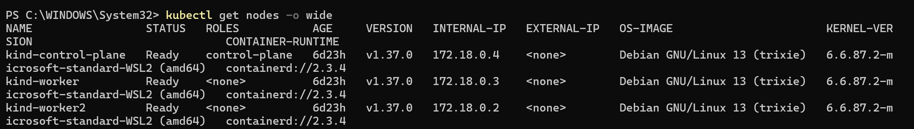
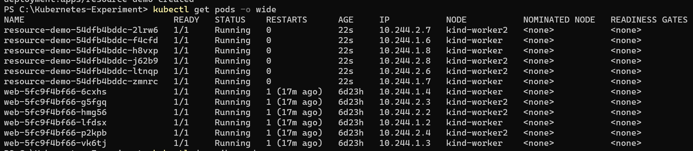
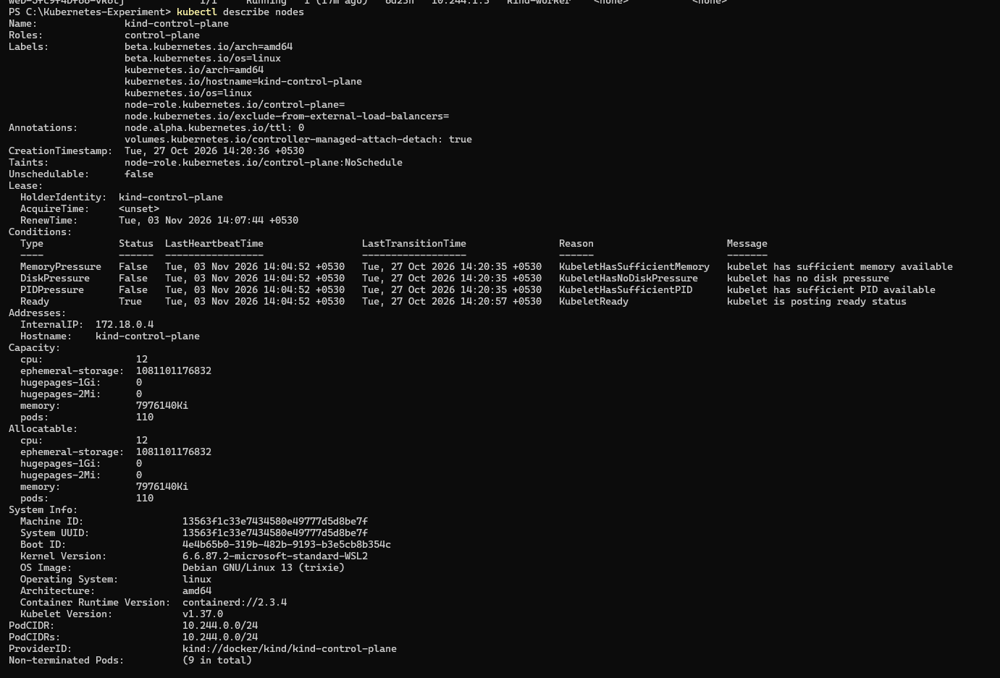
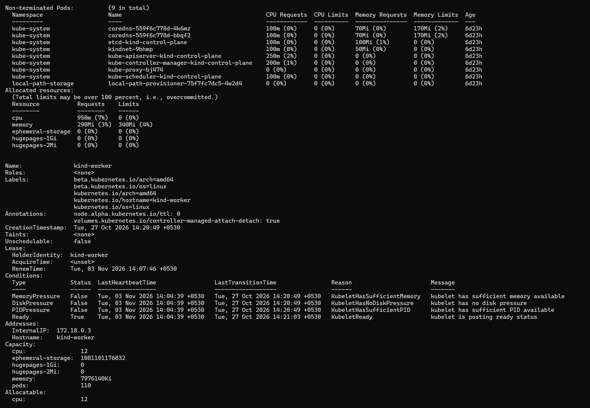
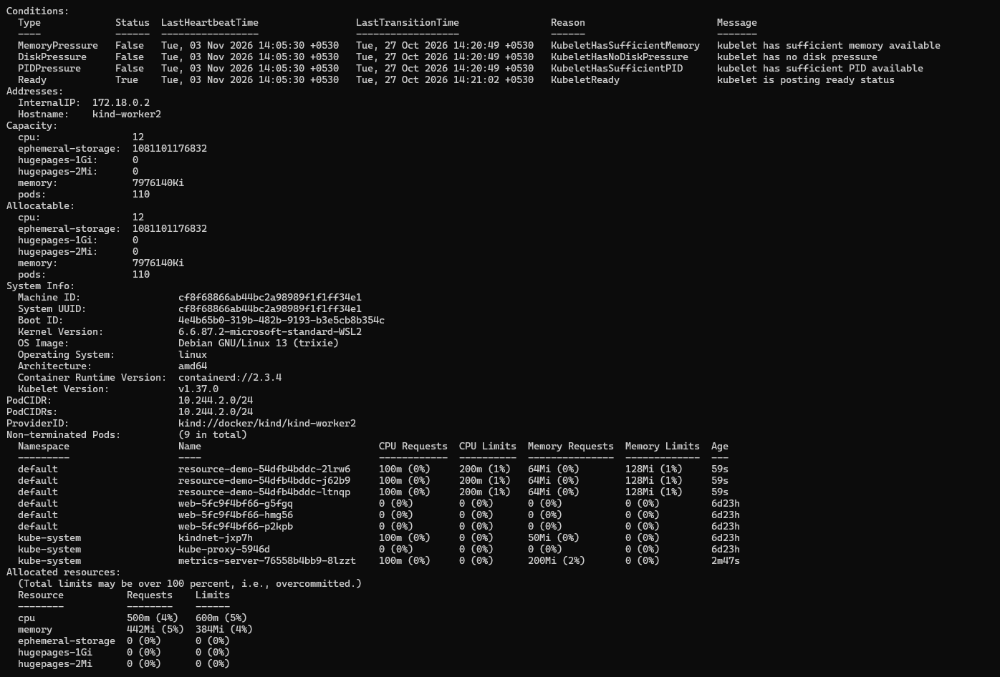
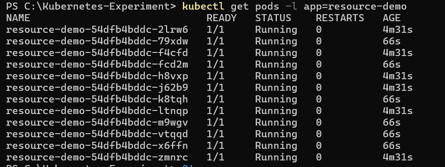
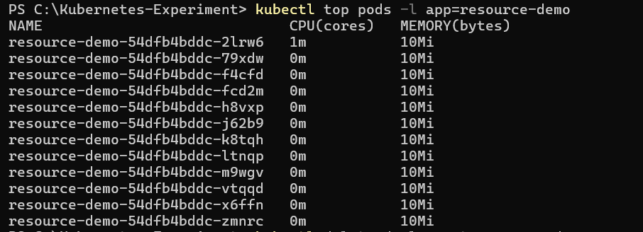
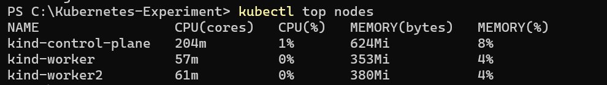

# Kubernetes Resource Allocation, Scheduling and Load Balancing

## 1. Project Overview

This experiment demonstrates resource allocation, pod scheduling, horizontal scaling, Service configuration, and resource monitoring in a three-node Kubernetes cluster using Kind.

An NGINX application is deployed with CPU and memory requests and limits. The experiment analyzes how Kubernetes distributes pods across worker nodes, scales the application, exposes it through a Service, and monitors resource utilization.

## 2. Objectives

- Create and verify a three-node Kubernetes cluster.
- Deploy an NGINX application using Kubernetes Deployment.
- Configure CPU and memory requests and limits.
- Analyze pod scheduling across worker nodes.
- Scale the application from 6 to 12 replicas.
- Expose the application using a NodePort Service.
- Verify Service endpoints and backend pods.
- Monitor CPU and memory utilization using Metrics Server.

## 3. Technologies Used

| Technology | Purpose |
|---|---|
| Kubernetes | Container orchestration |
| Kind | Local Kubernetes cluster |
| Docker Desktop | Container runtime |
| kubectl | Kubernetes command-line tool |
| NGINX | Sample application |
| Metrics Server | Resource monitoring |
| PowerShell | Command execution |

## 4. Cluster Architecture

The experiment uses a three-node Kubernetes cluster:

- 1 Control Plane Node
- 2 Worker Nodes

The control plane manages the cluster, while worker nodes run the application pods.

## 5. Experiment Implementation

### Step 1: Verify the Kubernetes Cluster

First, verify that all three nodes are available.

**Command:**

```powershell
kubectl get nodes -o wide
```

**Observed output:**

All three nodes were in the Ready state:

- kind-control-plane
- kind-worker
- kind-worker2

**Screenshot:**



### Step 2: Create the Deployment Configuration

Create a file named `deployment.yaml`.

This file defines the application, replica count, container image, CPU requests and limits, and memory requests and limits.

**File: `deployment.yaml`**

```yaml
apiVersion: apps/v1
kind: Deployment
metadata:
  name: resource-demo
spec:
  replicas: 6
  selector:
    matchLabels:
      app: resource-demo
  template:
    metadata:
      labels:
        app: resource-demo
    spec:
      containers:
      - name: nginx
        image: nginx
        resources:
          requests:
            cpu: "100m"
            memory: "64Mi"
          limits:
            cpu: "200m"
            memory: "128Mi"
```

**Apply the Deployment:**

```powershell
kubectl apply -f deployment.yaml
```

**Expected command result:**

```text
deployment.apps/resource-demo created
```

### Step 3: Verify Pod Scheduling

Check whether the six application pods have been created and scheduled.

**Command:**

```powershell
kubectl get pods -o wide
```

**Observed result:**

- 6 resource-demo pods were Running.
- 3 pods were scheduled on kind-worker.
- 3 pods were scheduled on kind-worker2.
- No resource-demo pods were scheduled on the control-plane node.

The control-plane node has a `NoSchedule` taint, which prevents ordinary application pods from being scheduled there.

**Screenshot:**



### Step 4: Analyze Node Resource Allocation

Use the following command to inspect node capacity, allocated resources, and pod resource requests and limits.

**Command:**

```powershell
kubectl describe nodes
```

The output includes:

- Node capacity and allocatable resources.
- Running pods on each node.
- CPU requests and limits.
- Memory requests and limits.
- Allocated resource percentages.

**Observed application resource configuration:**

| Resource | Request | Limit |
|---|---:|---:|
| CPU | 100m | 200m |
| Memory | 64Mi | 128Mi |

**Screenshots:**

Control Plane:



Worker Node 1:



Worker Node 2:



### Step 5: Scale the Application

Initially, the application was deployed with six replicas. Now increase the replica count to twelve.

**Command:**

```powershell
kubectl scale deployment resource-demo --replicas=12
```

**Verify the scaled pods:**

```powershell
kubectl get pods -l app=resource-demo -o wide
```

**Observed result:**

- Initial replicas: 6
- Desired replicas after scaling: 12
- Running replicas: 12
- Worker 1: 6 pods
- Worker 2: 6 pods

This demonstrates horizontal scaling in Kubernetes.

**Screenshot:**



### Step 6: Create the NodePort Service

Create a file named `service.yaml`.

A Service provides a stable network endpoint for accessing the application pods.

**File: `service.yaml`**

```yaml
apiVersion: v1
kind: Service
metadata:
  name: nginx-service
spec:
  type: NodePort
  selector:
    app: resource-demo
  ports:
  - port: 80
    targetPort: 80
    nodePort: 30080
```

**Apply the Service:**

```powershell
kubectl apply -f service.yaml
```

**Expected command result:**

```text
service/nginx-service created
```

### Step 7: Verify the Service and Endpoints

Check the created Service.

**Command:**

```powershell
kubectl get services
```

Check the backend endpoints.

**Command:**

```powershell
kubectl get endpoints nginx-service
```

Check EndpointSlices.

**Command:**

```powershell
kubectl get endpointslices
```

**Observed result:**

- The nginx-service Service was created.
- The Service used NodePort 30080.
- The Service selected the resource-demo application pods.
- Twelve backend endpoints were registered.

This verifies Service discovery and backend registration.

### Step 8: Access the NGINX Application

To access the Service from the Windows host, use port forwarding.

**Command:**

```powershell
kubectl port-forward service/nginx-service 8080:80
```

Open the following URL in a browser:

```text
http://localhost:8080
```

**Expected browser result:**

The NGINX Welcome page should be displayed.

### Step 9: Install and Configure Metrics Server

Metrics Server provides CPU and memory usage information for Kubernetes nodes and pods.

The experiment uses a modified Metrics Server manifest for the Kind environment.

**Configuration file:** `metrics-server-fixed.yaml`

The manifest uses the Metrics Server image:

```text
registry.k8s.io/metrics-server/metrics-server:v0.9.1
```

It also includes the kubelet TLS option:

```text
--kubelet-insecure-tls
```

**Apply the configuration:**

```powershell
kubectl apply -f metrics-server-fixed.yaml
```

Wait for Metrics Server to become ready:

```powershell
kubectl get deployment metrics-server -n kube-system
```

### Step 10: Monitor Resource Utilization

After Metrics Server is running, monitor node resource utilization.

**Command:**

```powershell
kubectl top nodes
```

Monitor individual application pods.

**Command:**

```powershell
kubectl top pods -l app=resource-demo
```

**Observed node resource usage after scaling:**

| Node | CPU Usage | CPU % | Memory Usage | Memory % |
|---|---:|---:|---:|---:|
| kind-control-plane | 204m | 1% | 624Mi | 8% |
| kind-worker | 57m | 0% | 353Mi | 4% |
| kind-worker2 | 61m | 0% | 380Mi | 4% |

The pod monitoring output showed all twelve resource-demo pods. Their displayed memory usage was approximately 10Mi per pod, with CPU usage between 0m and 1m.

**Screenshots:**

Node Resource Monitoring:



Pod Resource Monitoring:



## 6. Results and Observations

| Experiment | Result |
|---|---|
| Cluster verification | 3 nodes Ready |
| Initial Deployment | 6 pods Running |
| Pod scheduling | 3 pods on each worker |
| Resource allocation | CPU and memory requests and limits configured |
| Horizontal scaling | 6 to 12 replicas |
| Final scheduling | 6 pods on each worker |
| Service creation | NodePort Service created |
| Endpoint verification | 12 backend endpoints registered |
| Application access | NGINX Welcome page verified |
| Resource monitoring | Node and pod metrics displayed |

## 7. Conclusion

This experiment demonstrates Kubernetes resource allocation, pod scheduling, horizontal scaling, Service discovery, and resource monitoring using a three-node Kind cluster.

The NGINX application was deployed with six replicas and later scaled to twelve replicas. Kubernetes scheduled the application pods across the two worker nodes. A NodePort Service was configured, and twelve backend endpoints were registered.

Metrics Server was used to monitor CPU and memory utilization at both node and pod levels.

The experiment provided practical understanding of Kubernetes application deployment, resource management, scaling, networking, and monitoring.

## 8. Project Directory Structure

```text
Kubernetes-Experiment/
│
├── screenshots/
│   ├── 01-cluster-status.png
│   ├── 02-pod-scheduling.png
│   ├── 03-resource-allocation1.png
│   ├── 03-resource-allocation2.png
│   ├── 03-resource-allocation3.png
│   ├── 04-scaling.png
│   ├── 07-resource-monitoring1.png
│   └── 07-resource-monitoring2.png
│
├── deployment.yaml
├── service.yaml
├── metrics-server-fixed.yaml
└── README.md
```
